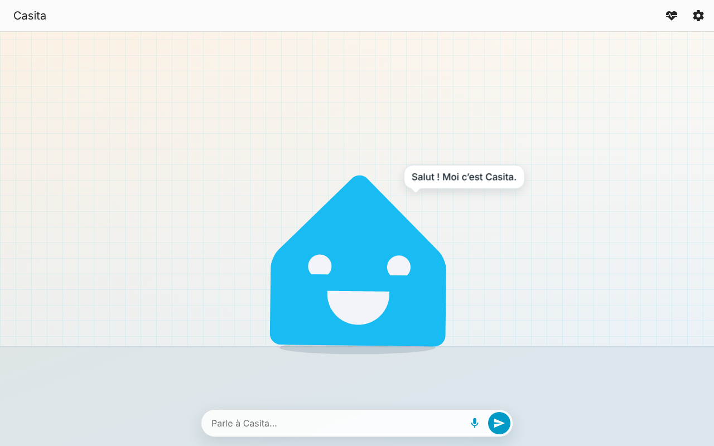

# Casita

Casita is a little house that lives in your Home Assistant. You talk to him with Assist, he controls your home, and he reacts with real emotions and moods.

> [!NOTE]
> Casita is a lab project, built with AI. It is not affiliated with the Home Assistant project or the Open Home Foundation.

## What you get

- **A Casita panel** in the sidebar. Casita lives there: talk to him by text or voice, pet him, poke him, toss him around. When nobody plays with him, he gets bored and falls asleep.
- **A conversation agent** for Assist. It is a wrapper: it sits on top of your own conversation agent and adds Casita's personality, an emotion on every reply and a mood.
- **Sensors** for his emotion and his mood, to use in your automations.

## How the agent works

Casita does not replace your conversation agent, it wraps it:

1. Casita first tries the request with the local agent of Home Assistant, like **Prefer handling commands locally** does. Simple commands ("turn on the light") stay local and fast.
2. Everything else goes to the LLM conversation agent you picked (OpenAI, Anthropic, Google…), with Casita's personality added to its prompt.
3. Every reply gets an emotion and moves Casita's mood.

Because Casita already does step 1, **turn off "Prefer handling commands locally" in the assistant that uses Casita**. If it stays on, the assistant handles simple commands before they reach Casita: they get no personality and no emotion.

Without an LLM agent, Casita only uses the local agent, and his emotions come from simple rules.

## Install

1. In HACS, add `https://github.com/piitaya/ha-casita` as a custom repository of type Integration.
2. Install Casita and restart Home Assistant.

Without HACS, copy `custom_components/casita` into the `custom_components` folder of your configuration and restart.

Casita needs Home Assistant 2026.10 or newer.

## Setup

1. Go to **Settings > Devices & services > Add integration > Casita**. If you have an LLM conversation agent (OpenAI, Anthropic, Google…), pick it. Leave it empty to stay local only.
2. Open the **Casita** panel in the sidebar and click **Create Casita assistant**. It copies your preferred assistant with Casita as the conversation agent.
3. Talk to Casita.

### Use Casita on a voice device

To talk to Casita through a Voice Preview Edition or another voice device:

1. Go to **Settings > Voice assistants** and open the assistant the device uses, or the Casita assistant created above.
2. Set **Conversation agent** to Casita.
3. Turn off **Prefer handling commands locally**. Casita already does it (see [How the agent works](#how-the-agent-works)).
4. On the device page, set its assistant to that one.

When you talk to the device, Casita reacts in the panel too.

Optional, in the Casita options:

- **AI Task entity** and **Restyle local replies**: local replies like "Turned on" are rewritten in Casita's voice. Use a fast model without extended thinking, for example Claude Haiku.
- **Weather entity**: the light of Casita's room follows the weather.

## FAQ

**My command went to the LLM, why?**
Local commands only match exact sentences. A typo, a missing accent or two devices with the same name in a room send the request to the LLM. The **Last local result** sensor of the Casita device tells you which case it was.

**Some commands get no emotion.**
The assistant has **Prefer handling commands locally** on. The assistant handles these commands itself and they never reach Casita. Turn it off: Casita already tries local commands first.

**Which language does Casita use?**
The language of the assistant you talk to. One exception: the Assist dialog opened from the Casita entity always uses English for speech. Use the Casita panel or a voice assistant instead.

**Replies are slow.**
Local commands answer in under a second. Requests that go to the LLM take as long as your LLM agent. Turn off extended thinking or pick a faster model.

## Documentation

- [How Casita works](docs/how-it-works.md): local first, the LLM, the rewrite, options, languages, debug logs.
- [Panel](docs/panel.md)
- [Emotions and mood](docs/emotions-and-mood.md): the 28 expressions, the rules and the mood sensors.
- [Reference](docs/reference.md): actions, sensors, event and websocket.

## License

MIT
